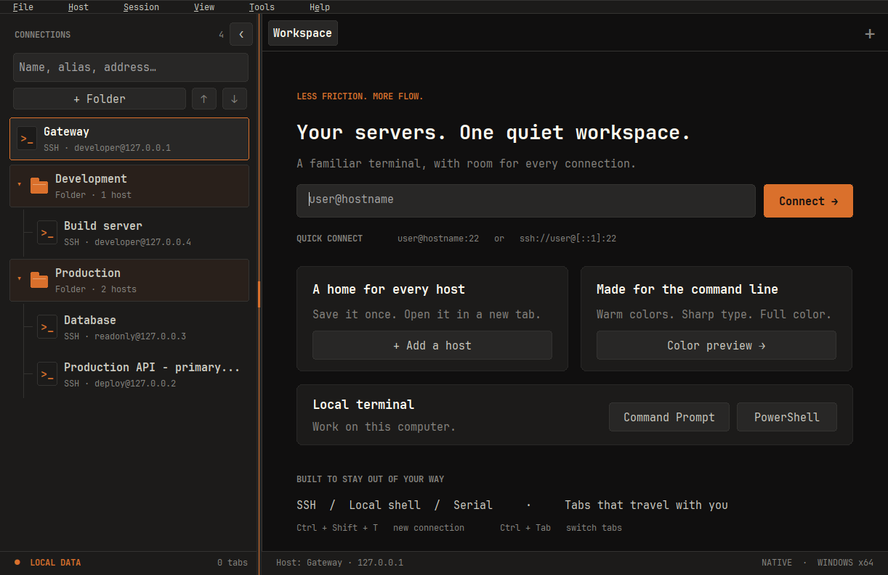
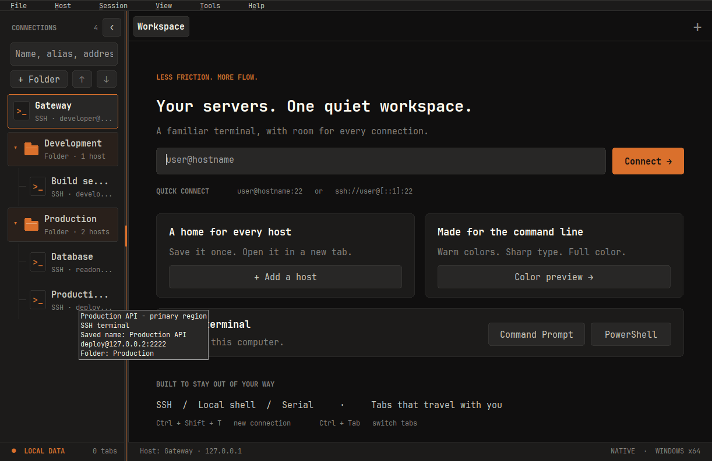

# Windows 1.2.21 — 폴더 구분, 탐색창 너비 조절과 툴팁

## 변경 사항

- 폴더에는 전용 폴더 아이콘·주황색 계열 배경·`Folder · N hosts` 설명을 표시합니다. 터미널은 `>_` 아이콘과 프로토콜·주소를 표시하며, 폴더 안의 연결은 들여쓰기와 연결선으로 묶습니다. 접근성 문자열도 Folder / Terminal을 구분합니다.
- 탐색창 오른쪽 경계를 좌우로 드래그하면 검색창·폴더 버튼·연결 목록이 함께 늘어나거나 줄어듭니다. 놓은 너비를 원자적으로 저장하며 다음 실행에도 복원합니다. Tab으로 경계에 포커스한 뒤 Left / Right로 조절하거나 Home으로 기본 폭을 복원할 수 있습니다.
- 기본 폭은 252, 조절 범위는 220~520 논리 픽셀입니다. 창이 작아지면 본문에 700 논리 픽셀을 남기도록 표시 폭만 제한하고, 다시 넓히면 사용자가 지정한 폭으로 돌아갑니다. 탭·분할 객체·입력 초안·선택·키보드 포커스·동기화 옵션을 보존합니다.
- 폴더·터미널에 마우스를 약 650ms 머물면 전체 이름과 상세 내용을 툴팁으로 보여줍니다. 호스트는 별칭·저장 이름·프로토콜·사용자·주소·포트·소속 폴더, 폴더는 이름·개수·펼침 상태를 안내합니다. 스크롤·검색·목록 변경·포인터 이탈 시 이전 설명을 제거합니다.
- 세션 제목·상태 표시줄·작업 버튼·분할 입력 컨트롤에도 툴팁을 추가했습니다. 좁아진 목록은 실제 너비에 맞춰 말줄임하고, 드래그 뒤 글자나 버튼 배경이 남지 않도록 다시 그립니다.

## 검증과 제한

- Linux Python 회귀 검사 **60개 통과**. 공유 너비 계산의 최소·최대 폭, 작은 창의 본문 공간과 선호 너비 복원을 포함합니다.
- Windows 앱·테스트 EXE 교차 빌드와 x64 형식·시스템 DLL 의존성·단일 EXE ZIP·내장 폰트/아이콘/라이선스 정적 패키지 검사를 통과했습니다. 소스·빌드 도구·SHA-256은 [manifest](../../release/1.2.21/manifest.json)에 기록합니다.
- Wine 8.0에서 `WOOK_TEST_NAVIGATION_ONLY=1` **44개 검사 통과**. 드래그와 캡처 취소, 너비 저장·복원, 작은 창의 제한, 키보드 조절, 행 변경·스크롤·검색·빈 공간의 툴팁, 실제 지연 표시, 축소 후 다시 그리기와 분할 객체·명령 초안·입력 옵션 보존을 확인했습니다. 분할 보존 검사는 프로세스를 시작하지 않는 테스트 탭을 사용하며 실제 SSH 입력 검증을 대신하지 않습니다.
- 별도로 실제 앱을 Wine·Xvfb에서 실행하고 X11 마우스로 360→450→220→360 폭을 드래그했습니다. 저장 파일의 너비, 버튼과 목록의 다시 그리기, 주기적 화면 갱신 중 툴팁 표시를 확인했습니다. 위 캡처는 이 EXE의 실제 화면이며 `build/` 아래 격리한 네 개의 루프백 예시 연결만 사용했습니다. 서버에 접속하거나 화면 내용을 합성하지 않았습니다.
- Wine에서 `core-tests.exe`를 실행했으나 `DPAPI decrypt for the current Windows user` 검사에서 실패하여 전체 핵심 검사는 **미통과**입니다. Wine의 결과를 Windows 실행 검증으로 표시하지 않습니다.
- 기존 연결 목록 통합 검사도 Wine에서 실행했으며 477개 확인 후 `Folder deletion confirmation must respond`에서 중단되었습니다. 보관된 1.2.20 테스트 EXE를 같은 격리 환경에서 비교 실행해도 동일한 위치에서 실패했습니다. 이 검사는 통과로 표시하지 않으며 Windows에서 삭제 확인·이후 검증을 다시 실행해야 합니다.
- Windows 실기의 CTest·실제 입력 라우팅·스크린리더·다중 모니터 DPI·SSH·SFTP·IME·DPAPI 및 NGS 검증은 **미실행**입니다. macOS·iPad 빌드와 GitHub Actions는 실행하지 않았으며 Windows EXE는 미서명입니다.

Windows에서는 `scripts/build.ps1`로 빌드한 뒤 `node tests/ssh/navigation-integration.cjs`, `node tests/ssh/connections-integration.cjs`, `node tests/ssh/focus-integration.cjs`로 탐색·폴더·실제 입력을 확인합니다. 상세 절차는 [개발 안내](../development.md), 동작은 [사용법](../usage.md#windows-탐색과-상단-메뉴)에 있습니다.

## 업데이트와 다운로드

기존 wShell 창을 모두 종료한 뒤 새 EXE를 실행하세요. 창이 남아 있으면 새 실행이 이전 버전 창으로 전달될 수 있습니다.

[wShell.exe](../../release/1.2.21/windows-x64/wShell.exe) · [ZIP](../../release/1.2.21/windows-x64/wshell-1.2.21-windows-x64.zip) · [manifest](../../release/1.2.21/manifest.json)

[최신 EXE 고정 링크](https://github.com/parkhw328/wook-shell/raw/refs/heads/main/release/latest/windows-x64/wShell.exe)도 이 버전으로 갱신하며 이미 공개한 버전별 원본은 보존합니다.
