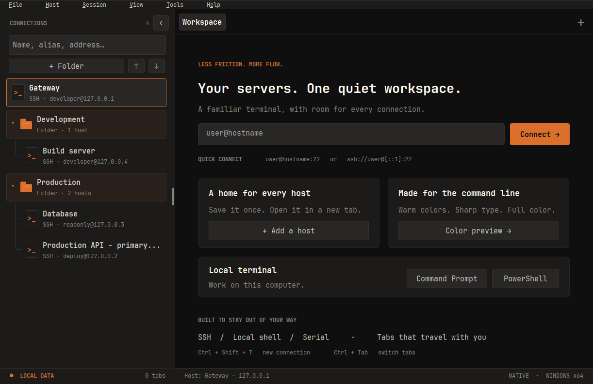
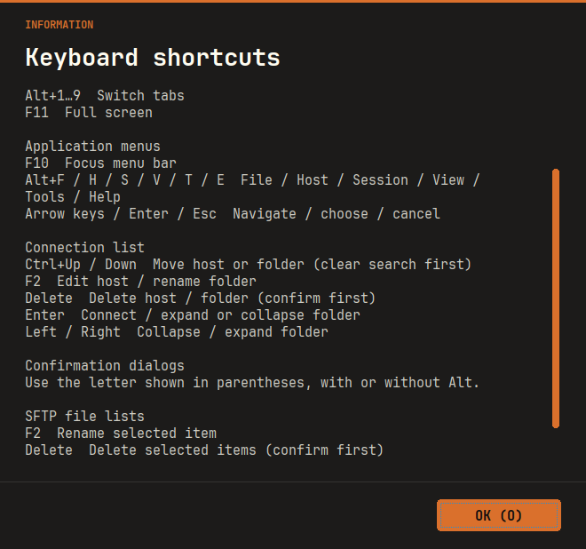
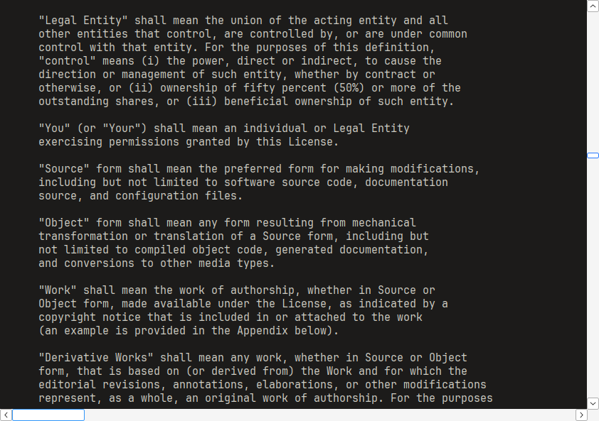

# Windows 1.2.22 — 탐색창과 Help 스크롤 표시 수정

## 변경 사항

- 탐색창 너비를 드래그할 때 왼쪽 버튼이 배경색으로 지워졌다가 다시 나타나는 깜빡임을 수정했습니다. 변경된 컨트롤 위치를 한 번에 적용하고, 네 개의 탐색 버튼은 배경·테두리·글자를 메모리에서 완성한 뒤 표시합니다.
- 크기나 위치가 바뀌지 않은 컨트롤을 다시 이동하지 않고, 동일한 접기 버튼 문구를 반복해서 설정하지 않습니다. 목록의 말줄임·스크롤바·노출 영역 갱신은 유지합니다. 기존 너비 저장·복원, 키보드 조절, 포커스와 분할 상태 보존도 유지합니다.
- 폴더의 마지막 자식 연결선은 가로 가지에서 `└` 모양으로 끝납니다. 검색 결과에서 마지막으로 일치하는 자식도 같은 방식으로 마감합니다. 스크롤 아래에 같은 폴더의 자식이 더 있으면 계속 연결하고, 다음 폴더나 빈 공간으로 선을 연장하지 않습니다.
- Help의 키보드 단축키·오픈소스 라이선스와 긴 알림 본문은 스크롤 후 보이는 텍스트 영역 전체를 갱신하고, 배경·글자를 메모리에서 함께 그립니다. 손잡이 드래그·휠·Page Up/Down·라이선스 가로 스크롤과 크기 변경 때 이전 글자 조각이 남지 않도록 했습니다. 기본 텍스트 컨트롤의 선택·복사·읽기 전용 동작은 유지합니다.

## 검증과 제한

- Linux Python 회귀 검사 **60개 통과**.
- Wine 8.0의 탐색 UI 검사 **77개 통과**. 수정 전 코드에서 버튼 배경 지우기가 중간 빈 화면을 만드는 검사의 실패를 먼저 확인했습니다. 수정 후 배경 보존, 이동 완료 전 그리기 방지, 변경된 버튼당 한 번의 그리기, 동일 레이아웃의 이동·문구 변경·그리기 생략을 검증했습니다. 기존 너비·툴팁·분할 보존 검사도 포함합니다.
- 실제 목록 그리기로 단일 자식·여러 자식·다음 폴더 앞·전체 목록 끝·접힌 폴더의 검색 결과·스크롤 아래에 자식이 남은 경우의 연결선 픽셀을 확인했습니다.
- Wine 8.0의 Help·공통 메시지 검사 **926개 통과**. 휠·행 이동·Page Down·단축키 손잡이 드래그·라이선스 스크롤 위치·가로 이동·크기 변경·선택·읽기 전용을 확인했습니다. 기존 About 링크·기본 버튼·문자/Alt 단축키·자동 반복 방지·Enter/Esc·긴 한글 본문·150% DPI 메시지·중첩 모달·포커스 복귀 검사도 포함합니다. 실제 SSH 연결은 이 검사에 포함하지 않습니다.
- Help 검사는 강제로 다시 그리기 전에 실제 화면 픽셀을 읽어 전체 재그리기 결과와 비교합니다. 이전 화면의 텍스트 조각을 넣고 한 줄 스크롤하는 복구 검사는 수정 전 실패, 수정 후 통과를 확인했습니다. Wine에서 사용자의 Windows 화면 깨짐 자체를 그대로 재현한 결과와는 구분합니다.
- Windows 앱·테스트 EXE 교차 빌드 및 단일 EXE ZIP·x64 형식·시스템 DLL 의존성·내장 폰트/아이콘/라이선스 정적 검사를 통과했습니다. 소스·빌드 도구·해시는 [manifest](../../release/1.2.22/manifest.json)에 기록합니다.
- Wine·Xvfb에서 실제 앱을 실행하여 X11 마우스로 360→450→220→360 폭을 연속 드래그하고 저장된 너비와 결과 화면을 확인했습니다. 캡처는 `build/` 아래 격리한 네 개의 루프백 예시 연결을 표시한 실제 EXE 화면이며 서버 접속이나 이미지 합성을 하지 않았습니다.
- 같은 실제 EXE에서 X11 마우스로 단축키 창의 손잡이와 라이선스 창의 가로·세로 손잡이를 왕복 드래그했습니다. 위 Help 캡처는 손잡이를 누른 상태의 화면입니다. Wine의 시스템 스크롤바 모양은 Windows 다크 테마와 다를 수 있습니다.
- Windows 실기·다중 모니터 DPI·실제 SSH/SFTP·IME·DPAPI·NGS와 전체 CTest는 **미실행**입니다. Wine 검사는 Windows 실기 검증을 대신하지 않습니다. macOS·iPad 빌드와 GitHub Actions는 실행하지 않았으며 Windows EXE는 미서명입니다.

Windows에서는 `scripts/build.ps1`로 빌드한 뒤 `node tests/ssh/navigation-integration.cjs`와 `node tests/ssh/help-scroll-integration.cjs`로 이번 회귀를 확인합니다. 상세 절차는 [개발 안내](../development.md)를 따릅니다.

## 업데이트와 다운로드

기존 wShell 창을 모두 종료한 뒤 새 EXE를 실행하세요. 창이 남아 있으면 이전 버전 창으로 전달될 수 있습니다.

[wShell.exe](../../release/1.2.22/windows-x64/wShell.exe) · [ZIP](../../release/1.2.22/windows-x64/wshell-1.2.22-windows-x64.zip) · [manifest](../../release/1.2.22/manifest.json)

[최신 EXE 고정 링크](https://github.com/parkhw328/wook-shell/raw/refs/heads/main/release/latest/windows-x64/wShell.exe)도 갱신합니다. 기존 버전별 배포 파일은 보존합니다.
