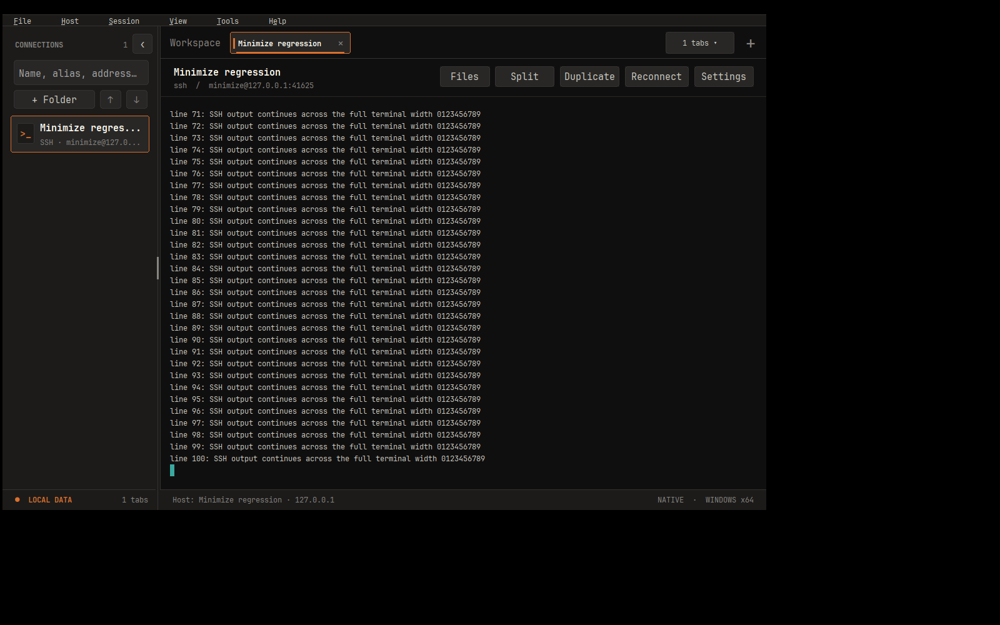

# wShell 1.2.23 — 최소화 후 터미널 폭 축소 수정

Windows에서 SSH 연결을 최소화해 두었다가 돌아왔을 때 출력이 왼쪽 끝에 몰리는 크기 전달 오류를 수정했습니다.

## 원인과 변경

작업 공간은 `WM_SIZE`의 최소화 알림을 무시했지만, 백그라운드 탭 종료나 엔진 창 연결 알림에서도 레이아웃을 계산했습니다. 이 경로가 최소화된 창의 작은 본문 크기를 읽으면 자식 터미널이 축소되고 SSH 서버에도 잘못된 PTY 열·행 수가 전달됐습니다. 작아진 크기로 출력된 내용은 복원 후에도 좁게 줄바꿈된 채 남을 수 있습니다.

이제 최소화 중에는 마지막 정상 작업 공간 크기를 재사용합니다. 크기 조회 실패나 빈 본문도 정상 크기를 덮어쓰지 않습니다. 탭 종료 정리·분할 대상·입력 동기화 갱신은 계속하며, 복원 후에는 실제 창 크기를 반영합니다. PuTTY의 터미널 해석이나 SSH 프로토콜 구현은 변경하지 않았습니다.

## 검증과 제한

- 수정 전 코드를 Wine 8.0·Xvfb에서 실행하여 최소화 중 레이아웃 실패를 확인했습니다. 별도의 실제 루프백 SSH 검사에서는 종료 상태를 알리는 테스트 핸들로 백그라운드 탭 종료 경로를 실행하자 서버의 PTY 크기가 **134열×31행 → 1열×1행**으로 줄었습니다.
- 수정 후 같은 SSH 검사는 최소화 전·중·복원 후 모두 **134열×31행**을 유지했고, 중간에도 축소 요청이 없었습니다. 출력이 계속 수신되는 동안 여러 상태 확인 주기를 거쳤으며, 복원 후 실제 창을 넓히면 **148열×34행**이 서버에 전달됐습니다.
- Wine의 최소화 회귀 검사 **103개 통과** 및 Node SSH 서버의 PTY·출력 검증 통과. 일반 창의 단일·2·3·4분할, 최대화 창의 단일·4분할, 영역 확대, 숨긴 터미널 크기, 탭·분할 객체·명령 초안·공통 입력 옵션 보존을 포함합니다. 종료된 탭 제거와 엔진 연결 알림의 레이아웃 경로도 검사합니다.
- Wine·Xvfb 데스크톱을 직접 캡처하여 최소화 중 수신한 SSH 출력이 복원 후 정상 폭으로 보이는 것을 확인했습니다. 아래는 격리된 루프백 서버의 합성 출력이며 실제 사용자 서버 정보는 없습니다. Wine에서 다른 프로세스의 터미널을 Win32 DC로 읽은 BMP에는 내용이 빠져, 화면 검토에는 X11 데스크톱 캡처를 사용했습니다.
- Linux Python 회귀 검사 **60개 통과**, JavaScript 구문 검사와 `git diff --check` 통과.
- Windows 앱·테스트 EXE 교차 빌드 및 단일 EXE ZIP·x64 형식·시스템 DLL 의존성·내장 폰트/아이콘/라이선스 정적 검사 통과. 소스·도구·해시는 [manifest](../../release/1.2.23/manifest.json)에 기록합니다.
- Windows 실기·장시간 최소화/절전·다중 모니터 DPI·전체 CTest·SFTP·IME·DPAPI·NGS는 **미실행**입니다. Wine의 루프백 SSH 검사는 Windows 실기나 사용자의 원격 서버 환경을 대신하지 않습니다. macOS·iPad 빌드와 GitHub Actions는 실행하지 않았으며 EXE는 미서명입니다.

Windows에서는 `scripts/build.ps1`로 빌드한 뒤 `node tests/ssh/minimize-integration.cjs`를 실행합니다. 검사 선택과 결과 파일은 [개발 안내](../development.md#최소화복원과-ssh-크기-회귀-검사), 동작 계약은 [작업 공간 요구사항](../../rules/requirements/workspace-ui.md#최소화와-터미널-크기)을 확인하세요.

## 업데이트와 다운로드

기존 wShell 창을 모두 종료한 뒤 새 EXE로 다시 연결하세요. 이미 좁은 폭으로 출력된 과거 내용까지 원래 줄바꿈으로 복원하는 변경은 아닙니다.

[wShell.exe](../../release/1.2.23/windows-x64/wShell.exe) · [ZIP](../../release/1.2.23/windows-x64/wshell-1.2.23-windows-x64.zip) · [manifest](../../release/1.2.23/manifest.json)

[최신 EXE 고정 링크](https://github.com/parkhw328/wook-shell/raw/refs/heads/main/release/latest/windows-x64/wShell.exe)도 갱신하며 기존 버전별 파일은 보존합니다.
