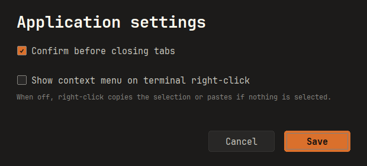

# wShell 1.2.24 — 터미널 우클릭 동작 선택

Windows의 **Tools → Application settings → Show context menu on terminal right-click**에서 기본 셸의 우클릭 동작을 선택할 수 있습니다.

| 설정 | 터미널에서 우클릭하면 |
| --- | --- |
| 해제 (기본값) | 선택한 텍스트를 복사하고 선택을 해제합니다. 선택이 없으면 붙여넣습니다. |
| 체크 | 클릭한 터미널의 컨텍스트 메뉴가 열립니다. **Copy** 또는 **Paste**를 선택하거나 Esc로 닫을 수 있습니다. |

**Save**를 누르면 열린 탭과 분리 창에도 바로 적용되며 다음 실행에서도 같은 설정을 사용합니다. 기본 모드에서도 **Ctrl+우클릭**으로 메뉴를 열 수 있습니다. 원격 프로그램에 마우스 입력을 직접 보내도록 설정한 연결은 해당 프로그램이 일반 우클릭을 처리합니다. [마우스 설정 사용법](../usage.md#마우스-복사붙여넣기-windows)

## 검증

- Linux에서 Windows x64 앱과 테스트 실행 파일을 교차 빌드했습니다. EXE에 기록된 파일·제품 버전은 모두 `1.2.24.0`입니다. ZIP에는 배포 EXE와 바이트가 같은 `wShell.exe` 한 개가 들어 있습니다. DLL 의존성, 내장 글꼴·아이콘·라이선스, SHA-256을 검사했습니다. [빌드 정보와 해시](../../release/1.2.24/manifest.json)
- Wine 8.0에서 배포 EXE를 단독으로 실행해 체크박스를 저장하고, 앱을 재시작해 복원된 상태를 확인했습니다. 변경을 취소했을 때와 다시 저장했을 때의 설정값도 확인했습니다.
- Wine과 루프백 SSH를 사용해 일반·대체 화면과 원격 앱 마우스 허용 여부를 조합한 네 가지 검사를 통과했습니다. 선택 영역 우클릭 복사, 다음 우클릭 붙여넣기, 메뉴 취소와 Paste를 선택했을 때의 한글 전송을 확인했습니다. Linux의 Python 회귀 테스트 60개도 통과했습니다.
- Wine에서 실행한 전체 `core-tests`는 1.2.23과 1.2.24 모두 현재 사용자의 DPAPI 비밀번호 복호화 검사에서 중단됐습니다. Windows 실기와 NGS 환경에서의 실행 검증은 남아 있습니다. Windows EXE는 미서명입니다.

## 다운로드

기존 wShell 창을 모두 닫은 뒤 새 EXE를 실행하세요. [Windows x64 EXE](../../release/1.2.24/windows-x64/wShell.exe) · [ZIP](../../release/1.2.24/windows-x64/wshell-1.2.24-windows-x64.zip)
