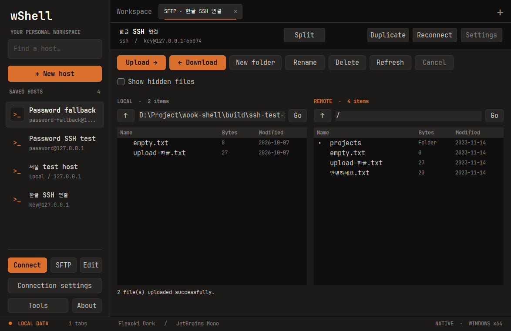
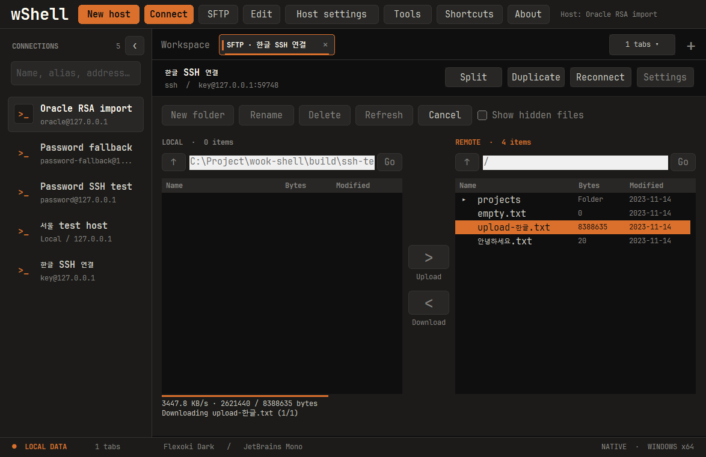

# SFTP 파일 탐색과 전송

저장한 SSH 호스트를 선택하고 **SFTP**를 누르면 전용 탭이 열립니다. Windows의 연결된 SSH 탭에서는 **Files**, macOS에서는 **Tools → Open SFTP**도 사용할 수 있습니다. SFTP 연결은 터미널과 독립적이므로 파일을 전송하면서 명령을 실행할 수 있습니다.

## 파일 이동

1. 왼쪽 **LOCAL**, 오른쪽 **REMOTE** 목록에서 폴더를 더블 클릭하거나 경로를 입력하고 **Go**를 누릅니다. **↑**는 상위 폴더로 이동합니다.
2. Windows에서는 로컬 파일을 선택하고 **두 목록 사이의 `>` (Upload)**, 원격 파일을 선택하고 **`<` (Download)**를 누릅니다. 선택한 쪽의 전송 버튼이 주황색으로 켜지고 전송 중에는 양쪽 버튼이 비활성화됩니다. macOS는 기존 **Upload → / ← Download** 버튼을 사용합니다. Ctrl/Command 또는 Shift로 여러 파일을 선택할 수 있습니다.
3. 같은 이름의 파일이 있으면 대상 경로와 파일 목록을 확인하고 교체를 선택합니다. 진행 상태에 현재 파일, 순서, 바이트 수가 표시됩니다. Windows에서는 업로드·다운로드 속도를 **KB/s**로 함께 표시합니다(1 KB = 1,024 bytes). 최근 약 1초의 실제 처리 바이트를 100ms 간격으로 계산하며 파일마다 초기화됩니다. 수신이 멈추면 속도도 0으로 내려갑니다.
4. **Cancel**은 해당 SFTP 연결을 종료합니다. 다른 터미널 탭은 유지되며, **Reconnect**로 파일 탐색을 다시 시작할 수 있습니다.

Windows 1.0.5부터 전송 중에도 두 파일 목록의 어두운 배경을 유지하며 목록을 스크롤할 수 있습니다. 전송 대상은 시작 시 선택한 파일로 고정되고, 전송 중 폴더 이동·새 전송·이름 변경·삭제는 계속 차단됩니다.

**New folder / Rename / Delete**는 주황색 제목으로 표시된 선택한 쪽에 적용됩니다. Delete는 휴지통을 거치지 않습니다. 폴더 삭제는 빈 폴더에만 적용됩니다. Refresh로 외부에서 바뀐 목록을 갱신하세요.

## 단축키 (Windows)

현재 개발 빌드에서 제공하는 기능입니다. 로컬 또는 원격 **파일 목록에 포커스**를 두고 사용합니다. 버튼에도 해당 단축키를 표시하며, 상단 **Shortcuts**에서 다시 확인할 수 있습니다.

| 단축키 | 동작 |
| --- | --- |
| `F2` | 키를 누른 목록에서 선택한 파일·폴더 하나의 이름 변경 |
| `Delete` | 키를 누른 목록의 선택 항목 삭제. 기존 확인창에서 승인해야 삭제됩니다. |
| `F5` | **Refresh**와 동일하게 로컬·원격 목록을 모두 새로고침 |

`F2`와 `Delete`는 선택 항목이 없으면 동작하지 않습니다. 연결·전송 등 작업 중이거나 연결이 끊긴 상태에서는 세 단축키를 실행하지 않습니다. Ctrl·Shift·Alt와 조합한 키는 이 작업에 연결하지 않으며, 경로 입력칸의 Delete는 텍스트만 편집합니다.

## 인증과 저장

저장한 호스트의 사용자·포트·개인키·암호와 wShell 호스트 키 확인을 재사용합니다. 새 연결이므로 키 암호나 추가 인증을 다시 요청할 수 있습니다. 저장 비밀번호는 Windows DPAPI / macOS Keychain의 기존 정책을 그대로 따릅니다. **Export / Import에는 암호와 개인키가 포함되지 않습니다.**

Windows는 단일 EXE 내부 SSH 엔진, macOS는 OS OpenSSH의 SFTP subsystem을 사용합니다. 별도 `psftp.exe`, `sftp.exe` 설치나 추출이 필요하지 않습니다. 파일 전송 연결에는 터미널 PTY·포트 전달·세션 로깅을 적용하지 않습니다.

## 전송 보호와 현재 범위

- UTF-8 파일명, 여러 일반 파일의 순차 전송, 빈 파일, 폴더 탐색·생성·이름 변경을 지원합니다.
- 다운로드는 목적 폴더의 임시 파일에 쓴 뒤 교체합니다. 업로드도 원격 임시 파일에 전송하며, 기존 파일 교체에는 서버의 `posix-rename@openssh.com` 지원이 필요합니다. 지원하지 않는 서버에서는 다른 이름을 사용하세요.
- 중단된 업로드는 원격 폴더에 `.wshell-*.part`가 남을 수 있습니다. 재연결 후 해당 임시 파일만 확인하여 삭제하세요. 이미 완료된 파일은 취소해도 되돌리지 않습니다.
- 폴더 전체의 재귀 전송·동기화·재개·드래그 앤 드롭·원격 파일 편집·권한 변경은 아직 지원하지 않습니다. 폴더 안으로 이동해서 파일을 선택하세요. 심볼릭 링크는 자동으로 따라가거나 전송하지 않습니다.
- Windows에서도 이동할 수 있는 파일명만 전송합니다. 경로 구분자, 장치명, 끝의 점/공백 등은 거부합니다. 목록은 폴더당 100,000개까지이며 SFTP v3 서버가 필요합니다.

## 검증

다운로드는 32KB 읽기 요청을 최대 64개(데이터 버퍼 2MB) 유지하고, 앞쪽 데이터가 저장되는 즉시 다음 요청을 보충합니다. 서버가 요청보다 적은 데이터를 보내면 다른 응답을 기다리는 동안 부족한 부분을 다시 요청합니다. 응답 순서가 달라도 파일에는 올바른 순서로 기록합니다. 긴 서버 핸들은 요청 바이트 수에 맞춰 동시 요청 수를 줄입니다.

Windows 로컬 빌드 후 `node tests/ssh/sftp-benchmark.cjs`로 성능 비교를 재현할 수 있습니다. ssh2 테스트 의존성 설치는 README의 검증 절차를 따릅니다. 이 검사는 8MB+3 bytes 파일, 응답 지연 40ms, 최대 응답 크기 32,768/17,003 bytes의 두 조건에서 업로드·다운로드 각각의 소요 시간·KB/s를 출력하고 양방향 전송 내용이 원본과 같은지 확인합니다. 테스트 데이터는 `build/sftp-benchmark-*`에 격리됩니다. 시간 기준 합격/실패는 두지 않으며 실제 서버·네트워크·디스크에 따라 속도는 달라집니다.

2026-10-10 Windows 로컬 비교에서 일반 응답은 3,157→1,719ms(2,594.9→4,765.6 KB/s), 짧은 응답은 20,078→1,594ms(408.0→5,139.3 KB/s)였습니다. 동일한 fixture에서 기존 배치 다운로드와 변경 후 코드를 각각 실행한 단일 측정이며 WinSCP 또는 사용자 서버와의 직접 비교는 아닙니다.

1.0.5 검증에서 CTest 4개와 SFTP 통합 검사가 통과했습니다. 전체 `integration.cjs`를 단독 실행해 SSH 검사 20개와 UI 검사 446개를 통과했습니다. 업로드·다운로드 중 양쪽 목록의 빈 영역이 실제로 어두운 배경인지, KB/s가 표시되는지, 작업 버튼이 비활성화되는지 검사했습니다. 생성된 화면을 확인했고, UI 왕복 전송 파일 8,388,635 bytes의 내용 일치도 확인했습니다.

`node tests/ssh/sftp-integration.cjs`는 독립 ssh2 루프백 서버에서 UTF-8 이름, 다중 패킷·짧은 읽기·응답 순서 변경, 전송 내용 일치, 폴더 작업, 덮어쓰기 거부와 취소를 확인합니다. `sftp-codec-tests`는 손상된 프레임·잘못된 ID·경로 순회와 확장 협상 외에 요청 보충, 짧은 응답 재요청, 중복 응답, 쓰기 실패, 조기 EOF, 취소 및 속도 계산을 검사합니다. Windows UI 테스트는 실제 SSH 키/저장 암호 연결과 업로드·다운로드 중 KB/s 표시를 검증합니다. macOS UI 테스트도 보존되어 있으나 이번 변경의 빌드·실행 검증은 Windows만 수행합니다. 실제 사용자 서버에는 테스트 파일을 쓰지 않습니다.

SFTP 단축키 회귀 검사는 Windows의 `node tests/ssh/integration.cjs`에 포함됩니다. `tests/sftp_shortcuts_smoke.inc`는 네이티브 목록·입력칸에 키 메시지를 보내 로컬·원격 이름 변경 대상, 삭제 확인의 기본 No·취소, 대화상자 종료 후 포커스, 수정키·선택 없음·작업 중 차단, 경로 텍스트 편집과 F5 양쪽 갱신을 검사합니다. 격리한 로컬·루프백 서버 폴더에 파일을 추가·제거하여 새로고침 결과를 확인하며, 실제 OS 키보드 입력 검사와 구분합니다. 이번 환경에서는 Windows 테스트 EXE의 교차 컴파일만 가능하며 UI 실행·스크린샷 확인은 미실행입니다.

## Hidden files

`Show hidden files` is **unchecked by default** in each SFTP tab. Check it to show dotfiles/dotfolders (such as `.env`, `.ssh`, `.config`) in both local and remote panes. Windows local files with the Hidden attribute and macOS local files marked hidden are also filtered. Unchecking immediately hides them again and clears selection; files are not deleted. Showing or hiding files does not change permissions or server settings.

## 1.0.6 — 깜빡임·전송 병목 수정 (2026-10-12)

- 전송 중 100ms 타이머가 전체 SFTP 화면을 무효화하던 경로를 하단 진행 표시 영역으로 제한하고, 부모 화면을 메모리 버퍼에 그린 뒤 복사하여 배경과 글자의 순차 그리기를 줄였습니다. 파일 목록의 기존 이중 버퍼는 유지합니다.
- Windows SSH 브리지의 10ms 타이머당 최대 64KB 입력 제한을 제거했습니다. PuTTY의 파이프 작업 스레드·이벤트 루프와 송수신 backlog 제어를 사용하며, stdout 쓰기가 SSH 이벤트 처리를 막지 않습니다.
- 클라이언트 수신 파이프의 `PeekNamedPipe` / `Sleep(5)` 폴링을 overlapped I/O로 교체했습니다. 데이터 도착·프로세스 종료·120초 타임아웃을 기다리며, 취소된 I/O의 완료를 확인한 뒤 버퍼를 반환합니다.
- 업로드는 16개 요청 단위로 응답을 전부 기다리는 대신 최대 64개(2MiB)의 요청을 유지하고, 각 응답 직후 빈 자리를 보충합니다. 진행률은 서버가 확인한 바이트 기준이며, 실패한 연결은 재사용하지 않습니다.

Linux에서 공통 코덱 회귀 검사 144개, Python 테스트 13개, Windows 교차 빌드와 패키지 정적 검사를 통과했습니다. Windows UI·SSH 실행 검증 및 WinSCP와 같은 서버/파일/네트워크에서의 속도 비교는 아직 수행하지 않았습니다. 위의 기존 1.0.5 실행 검증 결과는 이번 수정의 실행 검증을 뜻하지 않습니다. ASan 검사는 호스트 런타임 라이브러리 부재로 실행하지 못했습니다. 1.0.6 배포 파일은 `release/1.0.6/windows-x64/`에 있으며 `release/latest`는 이후 수정까지 포함한 최신 Windows 배포를 가리킵니다. 기존 `release/1.0.5`는 보존합니다. [릴리스 노트](releases/1.0.6.md)
