# 상세 사용법

[처음으로](../README.md) · [SFTP](sftp.md) · [분할 보기](split-view.md)

Windows 중심의 기능별 사용법입니다. 버전 표시는 기능 도입 시점이며, 현재 배포의 검증 상태는 [릴리스 노트](releases/1.2.2.md)를 확인하세요.

## Windows 탭 분리와 파일 드래그 (1.1.0)

- 탭을 창 밖으로 끌어 놓으면 기존 연결과 실행 중인 셸을 유지한 별도 창이 열립니다. 탭 우클릭의 **Move to new window**도 사용할 수 있습니다.
- 분리된 창의 탭을 다른 wShell 창의 탭 줄에 놓으면 다시 합쳐집니다. 마지막 탭을 돌려보낸 분리 창은 닫힙니다. 창을 닫으면 해당 창의 연결만 종료되며 다른 창은 계속 사용할 수 있습니다.
- 탐색기 파일을 SFTP의 **REMOTE** 목록에 놓으면 현재 원격 폴더에 업로드합니다. SFTP의 **LOCAL ↔ REMOTE** 목록 사이에서도 파일을 끌어서 전송할 수 있습니다.
- **REMOTE**의 파일을 탐색기 폴더나 바탕 화면에 끌어 놓으면 다운로드합니다. 모두 복사 방식이며 원본은 삭제하지 않습니다. 탐색기 다운로드는 임시 디스크 공간을 사용하고, 전송 중 SFTP의 **Cancel**로 취소할 수 있습니다. 드래그를 놓기 전에는 Esc로 취소합니다.
- 폴더가 포함된 선택은 전체 전송을 중단하고 “폴더는 다운로드하거나 업로드할 수 없습니다” 안내를 표시합니다. 폴더를 열어 파일만 선택해 주세요. 심볼릭 링크·정션은 따라가지 않습니다.
- 같은 이름의 파일은 기존 전송 확인을 거칩니다. 탐색기로 다운로드할 때의 충돌 처리는 탐색기가 담당합니다. 연결 준비 중·종료 중인 터미널과 전송 중인 SFTP 탭은 창 이동을 잠시 제한합니다.

Windows 1.1.0부터 지원하며 `release/latest`에서도 받을 수 있습니다. Windows 개발 빌드는 `powershell -NoProfile -ExecutionPolicy Bypass -File scripts/build.ps1 -EngineOnly`로 만들며 실행 파일은 `build/native/wShell.exe`입니다. 회귀 검증은 `node tests/ssh/drag-integration.cjs`로 수행합니다. 이 검사는 실제 로컬 셸·루프백 SFTP·OLE 데이터 형식을 검증하며, 실제 탐색기 마우스 드롭과 서로 다른 모니터 배율은 별도의 수동 확인 대상입니다.

## 분할 보기

여러 탭을 연 뒤 **Split**에서 2·3·4분할을 선택합니다. 영역을 클릭하면 입력 대상이 바뀌며, **Single pane**으로 돌아가도 연결은 유지됩니다. Windows `Ctrl+Shift+S`, Mac `⌘⇧S`. [자세한 사용법](../docs/split-view.md)

Windows 0.9.1에서는 실제 키보드 입력을 받는 영역의 커서와 주황색 테두리가 깜빡이며 **ACTIVE**로 표시됩니다. 하단 명령창을 편집하는 동안에는 전송 대상만 **SELECTED**로 표시하고 테두리 깜빡임을 멈춥니다. 분할을 선택한 직후 바로 입력할 수 있고, 터미널 본문을 클릭하면 포커스가 돌아옵니다. **Zoom / Back** 또는 `Ctrl+Shift+Enter`로 현재 영역을 확대하고 원래 분할로 복귀합니다. `Ctrl+Alt+방향키`로 인접 영역에 포커스를 옮깁니다.

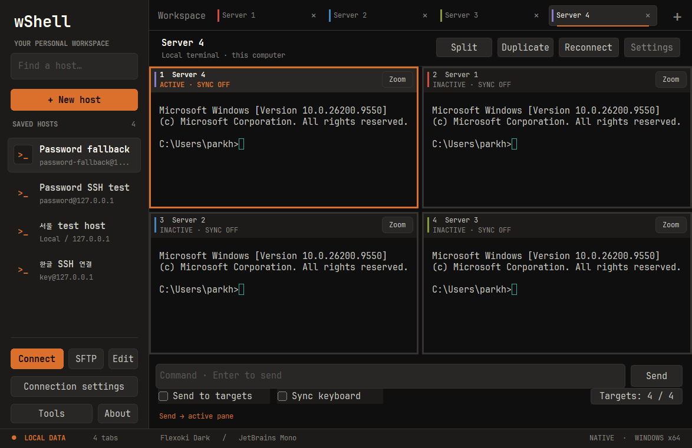

## 호스트 별칭·색상과 공통 입력

Windows·Mac의 호스트 편집 화면에서 **Alias**와 **Tab color**를 지정합니다. 별칭과 색상은 탭과 분할 영역을 구분하며 설정 백업에도 포함됩니다.

Windows 0.13.0부터 지정한 색상을 **탭 상단 전체 색상 띠와 배경**에 표시합니다. 활성 탭은 주황색 외곽선·하단 표시와 굵은 이름으로 구분합니다.

분할 화면 하단에 명령을 입력하고 Enter 또는 **Send**를 누르면 현재 영역으로 보냅니다. Windows는 **Targets**에서 대상을 선택하고 **Send to targets**를 체크하면 선택한 영역에 보냅니다. Mac은 기존 **Send to all panes**를 사용합니다. **Sync keyboard**는 터미널에서 타이핑·방향키·Backspace·Ctrl+C·붙여넣기를 동시에 전달하는 별도 옵션입니다.

Windows에서 **Sync keyboard** 또는 `Ctrl+Shift+B`를 누르면 활성 터미널로 포커스가 돌아갑니다. 그 터미널 안에서 방향키·Home/End·Delete로 여러 창을 함께 편집합니다. 공통 명령창의 방향키는 보내기 전 초안만 편집하며, `Ctrl+Shift+K`로 명령창에 이동합니다. **Targets**에서 제외한 영역은 독립적으로 입력할 수 있습니다. 서로 다른 셸·편집기 내용의 커서 좌표 자체를 일치시키는 기능은 아닙니다.

두 옵션은 기본 해제이며 분할 대상이 바뀌면 해제됩니다. Windows는 확대/복귀와 재연결 시에도 해제합니다. 숨겨진 탭·SFTP·인증 중인 연결은 제외합니다. 자세한 범위와 플랫폼 차이는 [분할 입력 사용법](../docs/split-view.md), 변경 내역은 [0.9.1 릴리스 노트](../docs/releases/0.9.1.md)를 확인하세요.

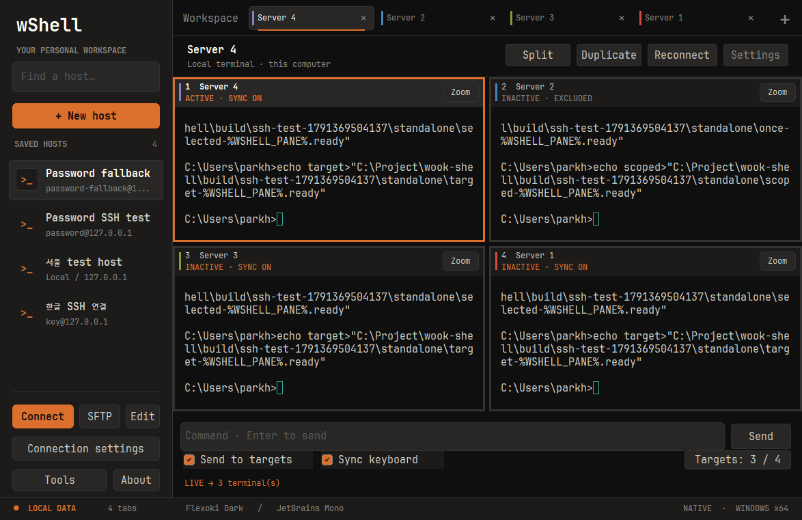

## Windows 탐색과 상단 메뉴

**CONNECTIONS 옆 ‹ 버튼** 또는 `Ctrl+Shift+H`로 왼쪽 목록을 접고 펼칩니다. 접어도 왼쪽의 좁은 탐색 영역에 **› 버튼**이 남아 바로 펼칠 수 있습니다. 버튼의 툴팁은 **Hide hosts / Show hosts**입니다. 다음 실행에도 표시 상태를 기억하며, 분할 창·명령 초안·키보드 동기화 대상과 옵션은 그대로 유지됩니다. `Ctrl+Shift+P`는 숨긴 탐색창을 펼치고 검색 칸으로 이동합니다.

**New host · Connect · SFTP · Edit · Host settings · Tools · About**은 상단에 고정됩니다. 호스트 작업은 목록에서 선택한 저장 연결을 대상으로 하며, 버튼에 마우스를 올리면 대상 이름과 주소를 확인할 수 있습니다. 세션 도구 모음의 **Files / Settings**는 현재 활성 탭에 적용됩니다.

검색 안내는 **Name, alias, address…**이며 이름·별칭·주소·그룹·사용자를 검색합니다. 선택할 결과가 없으면 Connect·SFTP·Edit이 비활성화됩니다. [0.10.0 변경 내역](../docs/releases/0.10.0.md), [작업 공간 UI 규칙](../rules/workspace-ui.md)

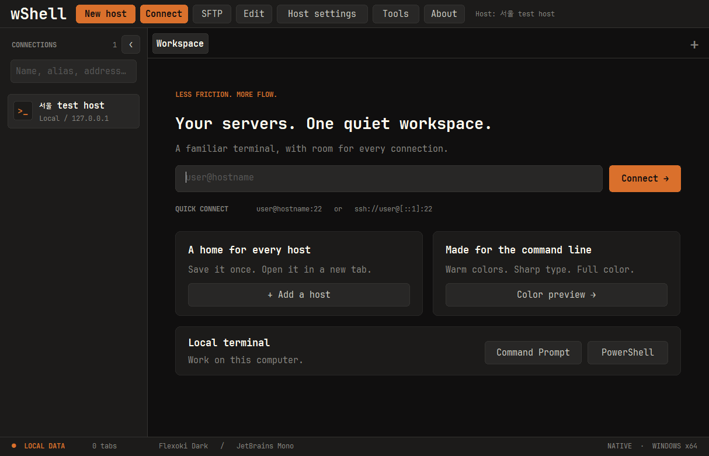

### Windows 연결 폴더와 표시 순서

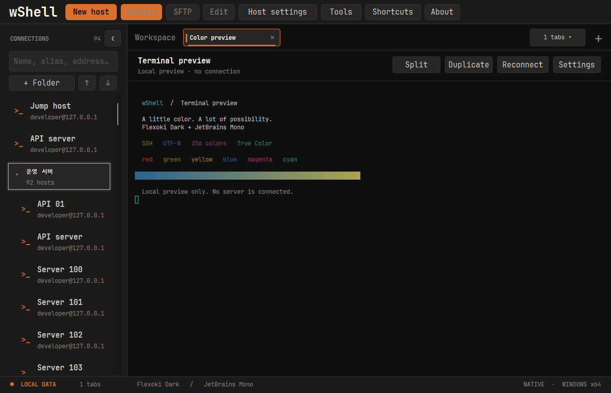

왼쪽 목록의 **+ Folder**로 폴더를 만들고, 폴더 우클릭의 **Rename folder / Delete folder**로 이름을 바꾸거나 삭제합니다. 기존 호스트의 Group 값도 폴더로 표시됩니다. 폴더 화살표 또는 Enter·더블클릭으로 접고 펼치며, 빈 폴더와 접힘 상태도 저장됩니다. 폴더를 삭제하면 안의 호스트는 폴더 밖으로 이동하고 연결 설정과 열려 있는 터미널은 유지됩니다.

호스트 우클릭의 **Move to folder**에서 이동할 폴더를 선택합니다. **No folder**는 폴더 밖으로 옮깁니다. New host / Edit의 **Folder**에서도 기존 폴더를 선택하거나 새 이름을 입력할 수 있습니다. 폴더를 선택한 채 New host를 누르면 해당 폴더가 미리 선택됩니다. 폴더는 한 단계 그룹으로 관리합니다.

호스트 또는 폴더를 선택하고 검색 칸 아래의 **↑ / ↓**, 우클릭의 **Move up / Move down**, 목록에서 **Ctrl+Up / Ctrl+Down**으로 순서를 바꿉니다. 호스트는 같은 폴더 안에서, 폴더는 폴더 목록 안에서 이동합니다. 폴더 없는 호스트가 먼저 표시됩니다. 순서는 재실행 후에도 유지되며, 상단의 열린 터미널 탭은 기존 드래그 및 Move left / Move right로 별도 정렬합니다.

검색은 접힌 폴더 안의 호스트도 표시하고 검색을 지우면 접힘 상태를 복원합니다. 저장된 순서를 바꾸려면 검색을 먼저 지웁니다. **F2**는 선택한 호스트 편집 또는 폴더 이름 변경, **Left / Right**는 폴더 접기·펼치기입니다.

`.wshell` 백업에는 호스트의 폴더·순서와 빈 폴더·접힘 상태가 포함됩니다. 기존 설정을 가져올 때는 현재 저장된 호스트와 폴더 설정을 덮어쓰지 않습니다. 폴더 정보가 포함된 새 백업은 이 기능을 지원하는 Windows 빌드에서 복원합니다. 기존 macOS·iPad 및 이전 Windows 빌드의 가져오기에는 새 폴더 레코드가 지원되지 않습니다.

개발 빌드는 기존 `powershell -NoProfile -ExecutionPolicy Bypass -File scripts/build.ps1 -EngineOnly`로 만들고, `node tests/ssh/connections-integration.cjs`로 격리된 Windows 창에서 폴더 생성·이름 변경·취소·삭제 확인, 순서 저장, 검색, 94개 연결과 스크롤바, 최소 창 크기를 검증합니다. 서버 연결은 필요하지 않습니다. 저장·백업·실패 시 복구는 `.tools/cmake-4.4.4-windows-x86_64/bin/ctest.exe --test-dir build/native/workspace --output-on-failure`의 core 테스트에서 검증합니다.

## Windows 연결과 탭

0.11.0부터 탭이 늘면 폭을 줄이고, 최소 폭에 도달하면 **‹ / ›** 버튼과 휠 스크롤을 제공합니다. 탭 줄의 **3–5 / 32 ▾** 같은 표시는 현재 보이는 범위와 전체 개수입니다. 이 버튼을 누르면 숨겨진 탭까지 전체 이름·주소로 선택할 수 있습니다. `Ctrl+Tab` 전환·새 탭·창 크기 변경 시 선택한 탭이 자동으로 보입니다. 탭 줄만 스크롤할 때에는 현재 연결과 분할 입력 대상이 유지됩니다. [0.11.0 변경 내역](../docs/releases/0.11.0.md)

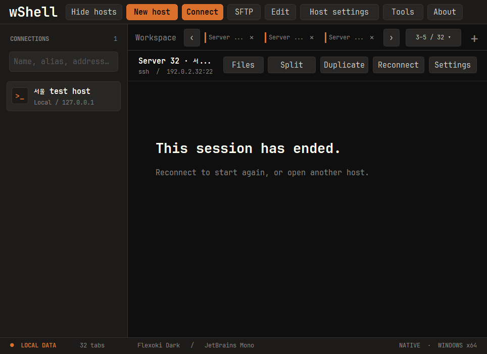

탭 우클릭에서 **Close other tabs**(이 탭만 남기기), **Close tabs to the right**(오른쪽 탭 닫기), **Close all tabs**(모두 닫기)를 사용할 수 있습니다. 전체 탭 메뉴에도 나머지·모두 닫기가 있습니다. 실행 중인 연결을 닫을 때에는 한 번만 확인하며, 취소하면 탭과 분할·명령 초안을 유지합니다. [0.12.0 변경 내역](../docs/releases/0.12.0.md)

닫기 확인의 기본 선택은 **Close**입니다. **Don't ask again when closing tabs**를 체크하고 닫으면 다음부터 개별·일괄 탭 닫기를 확인 없이 실행합니다. 취소하면 이 설정도 바뀌지 않습니다. **Tools → Application settings → Confirm before closing tabs**를 체크하고 **Save**하면 확인창을 복원합니다. 앱 전체를 종료할 때의 확인은 별도입니다.

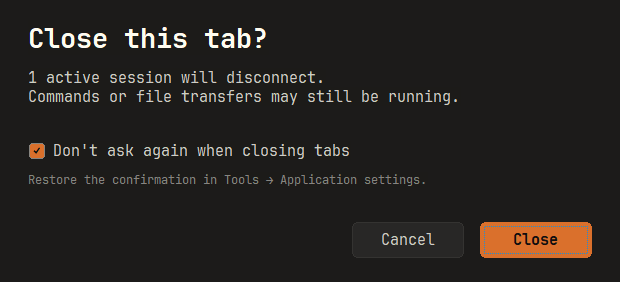

### 실행 인자로 SSH 접속

```powershell
.\wShell.exe -ssh deploy@192.0.2.10 -P 2222 -pw "<password>"
.\wShell.exe --host 192.0.2.10 --user deploy --port 2222 --name "개발 서버"
.\wShell.exe --help
```

같은 주소·포트·계정의 호스트가 있으면 그대로 재사용하고, 없으면 저장 후 접속합니다. `--name`은 새 호스트의 저장 이름입니다. 그 이름이 다른 연결에 사용 중이면 덮어쓰지 않고 오류를 표시합니다. 이름·IP·계정은 별개로 지정할 수 있으며 `ssh://user@[IPv6]:port`도 지원합니다. 이 기능은 Windows의 SSH 접속용으로, PuTTY의 모든 실행 옵션을 지원하지는 않습니다.

`-pw` 또는 `--password`는 이번 접속에 한 번만 사용하고 기존 저장 암호를 변경하지 않습니다. 재접속·복제에도 계속 사용하려면 Edit에서 암호 저장을 명시적으로 선택하세요. 최초 실행 인자의 암호는 프로세스 목록·셸 기록에 남을 수 있습니다. 자동화에서는 **`--password-stdin`으로 UTF-8 파이프 입력**을 사용하거나 암호 인자를 생략하고 터미널에서 입력하세요. 앱은 암호를 자식 프로세스 인수·환경변수·평문 파일에 재전달하지 않습니다. 처음 보는 서버의 키 지문 확인과 불일치 차단은 그대로 유지됩니다.

### 파일 전송

**SFTP:** SSH 호스트를 선택하고 `SFTP`를 누르면 로컬·원격 파일 목록을 나란히 볼 수 있습니다. 여러 파일 전송, 진행률·취소, 폴더 생성·이름 변경·삭제를 지원합니다. Windows SSH 탭의 `Files`, macOS의 `Tools → Open SFTP`에서도 열 수 있습니다. 폴더 전체 재귀 전송·동기화는 아직 지원하지 않습니다. [사용법과 지원 범위](../docs/sftp.md)를 확인하세요.


- **호스트 관리:** 저장·편집·복제·삭제, 이름/별칭/주소/그룹/사용자 검색, 더블 클릭으로 연결.
- **탭:** 새 연결, 독립 세션 복제, 드래그 재정렬, 가운데 클릭으로 닫기, 연결 재시작.
- **터미널:** UTF-8/한글, ANSI·256색·24비트 True Color, 선택/복사/붙여넣기, 10,000줄 스크롤백, 전체 화면.
- **연결 설정:** 상단 `Host settings`에서 프록시, SSH 터널, X11 전달, 키 인증, 로깅, 키보드/터미널 설정을 사용합니다. 설정 이름이나 항목으로 검색할 수 있으며, 긴 페이지는 스크롤합니다. 연결 중에는 `Settings`에서 변경하고 `Apply changes`로 적용하거나 `Cancel`로 취소하세요.
- **프로토콜:** SSH, Telnet, Rlogin, Raw TCP, Serial. Serial은 `New host`에서 COM 포트와 전송 속도를 지정합니다.
- **도구:** 자체 SSH 키 관리, 설정 내보내기/가져오기, 데이터 폴더 열기, 내장 라이선스 보기, 탭 목록 선택.
- **미리 보기:** `Color preview`는 서버 연결 없이 실제 터미널 엔진의 색상을 보여 줍니다.
- **로컬 셸:** 홈 또는 `Tools`에서 `Command Prompt` / `PowerShell`을 엽니다. `Ctrl+Shift+L`은 CMD를 열며, 탭 복제·전환·종료도 사용할 수 있습니다. ConPTY를 통해 이 PC의 명령을 실행하며 기본 작업 폴더는 현재 사용자의 홈입니다.

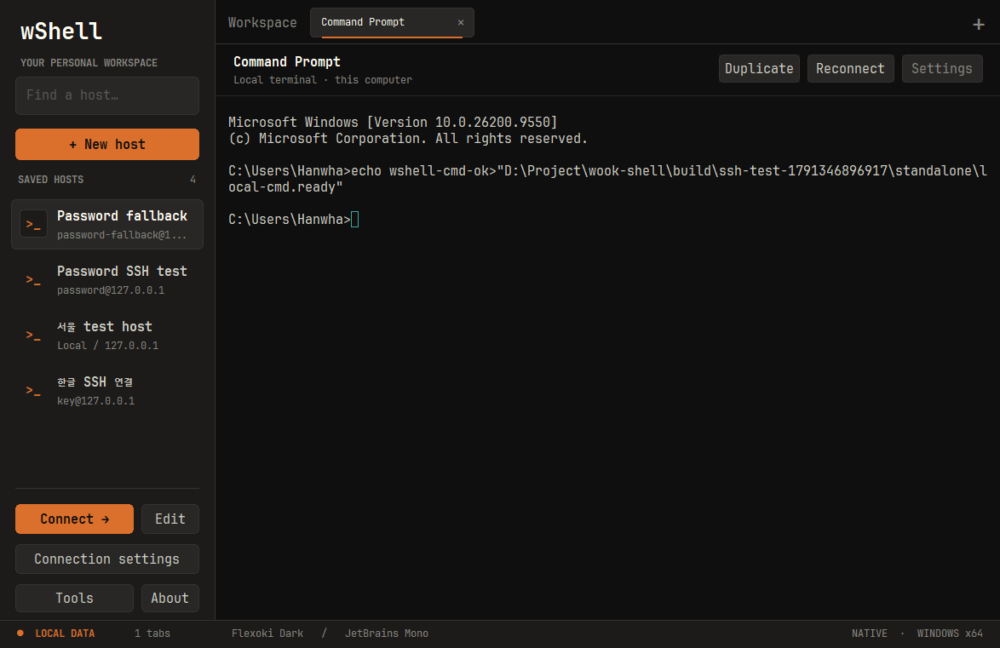

각 탭은 같은 `wShell.exe`의 별도 프로세스로 연결을 관리합니다. PuTTYgen, Pageant나 설치된 SSH 서비스에 의존하지 않으며, 외부 에이전트 인증·에이전트 전달·연결 공유는 사용하지 않습니다.
연결 설정·세션 설정·호스트 인증기관 관리 창은 wShell의 Flexoki Dark 화면을 사용합니다. 기존 엔진의 설정과 검증 로직을 유지하면서 탐색, 검색, 입력, 버튼과 스크롤을 새로 구성했습니다.

앱의 글꼴은 **JetBrains Mono Regular/Bold**로 통일했습니다. 본문·입력·버튼 11pt, 보조 정보 9pt, 섹션 제목 13pt, 페이지 제목 20pt를 공통으로 적용합니다. Windows 새 터미널의 기본 크기는 **9pt**이며 호스트별로 조절할 수 있습니다. 기존 저장 크기는 유지합니다. macOS 기본 크기는 13pt입니다. Windows의 파일 선택창 등 시스템 대화상자는 OS 설정을 따릅니다.
버튼·선택·포커스 강조색은 따뜻한 주황색 `#DA702C`입니다. 앱과 설정 화면의 왼쪽 상단에는 `wShell` 텍스트만 표시합니다. 실행파일 아이콘은 차콜 배경의 주황색 커맨드 창 안에 `>_` 프롬프트를 넣은 형태이며, 터미널의 ANSI·True Color 출력은 기존 색상을 유지합니다.

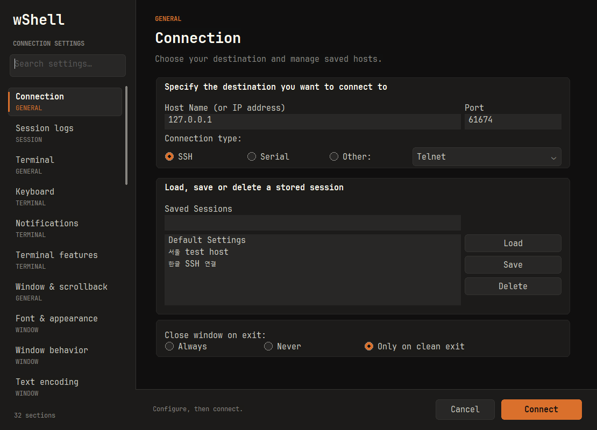

## 방향키 수정키 호환성

Windows 1.0.8부터 Shift·Ctrl·Alt+방향키의 수정키 정보를 애플리케이션 커서 모드에서도 유지합니다. [원인·설정 변경·검증 방법](../docs/modified-arrow-keys.md)을 확인하세요.

## 한글 입력 보정

Windows에서는 한글 조합을 별도 팝업 대신 **터미널 커서 자리**에 표시합니다. 터미널과 같은 글꼴·크기·배경을 사용하며, 조합 중인 글자는 주황색 밑줄로 구분합니다. 한글은 두 칸 폭에 맞추고 창 크기·커서 위치를 따라 이동합니다. SSH와 로컬 CMD/PowerShell에 별도 설정 없이 적용됩니다.

조합 중인 글자는 화면에만 표시하며 확정된 글자만 전송합니다. 탭을 옮길 때는 기존 탭에서 조합을 마무리합니다. 한자 등 후보 선택창은 Windows 기본 기능을 유지하며 조합 위치에 맞춰 배치합니다. macOS도 조합 밑줄·선택 범위와 attributed 확정 문자열을 처리합니다. JetBrains Mono에 없는 한글 글리프는 OS 글꼴로 보완합니다.

자동 검증은 합성 조합 이벤트·취소·한글 폭·리사이즈와 실제 루프백 SSH의 한글/이모지 전송을 포함합니다. OS 입력기별 실제 타이핑·후보창 동작은 [수동 확인 절차](../docs/ime-input.md)를 따릅니다. 서버의 문자 인코딩이나 셸 편집 동작은 변경하지 않습니다.

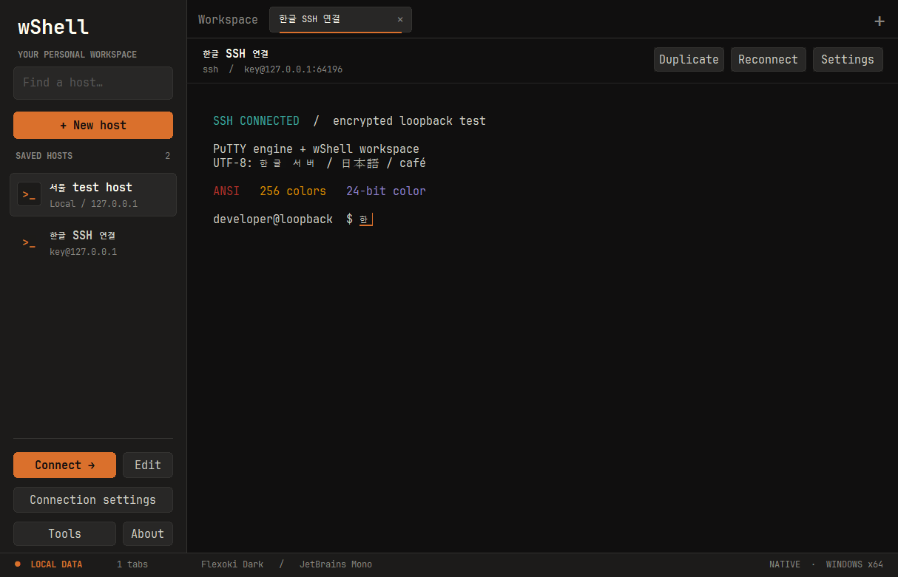

## 공개키 인증과 SSH 키 관리

SSH의 **공개키 인증은 키 쌍을 사용**합니다. 서버의 `~/.ssh/authorized_keys`에 공개키(`.pub`)를 등록하고, wShell은 대응하는 개인키로 서명합니다. 공개키 파일만으로는 로그인할 수 없습니다. 외부 에이전트의 키는 사용하지 않습니다.

`Authentication → Public key authentication`을 선택하고 개인키 경로를 지정하세요. Windows는 PPK뿐 아니라 **OpenSSH 및 기존 PEM 형식의 `.key`·`.pem` 개인키**를 가져올 수 있습니다. 호스트를 저장하거나 접속할 때 PPK 사본을 등록하며, **Choose or import a registered key → Use key**로 다른 호스트에서도 재사용합니다. macOS는 기존 OpenSSH 경로를 사용합니다. 개인키는 서버에 업로드하지 마세요.

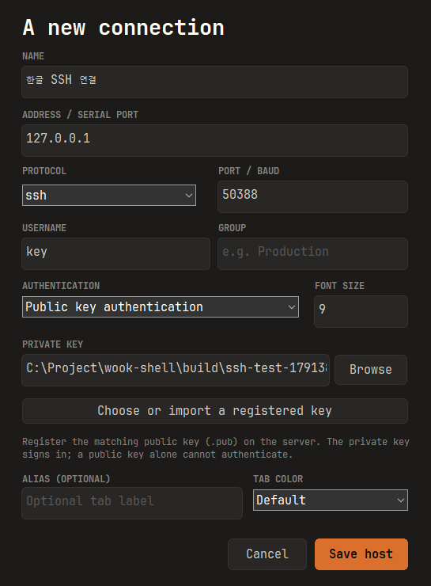

`No supported authentication methods available (server sent: publickey,gssapi-keyex,gssapi-with-mic)`가 나오면 서버가 비밀번호 인증을 제공하지 않는 상태입니다. 올바른 사용자 이름과 해당 사용자에 등록된 공개키의 **짝이 되는 개인키**를 확인하세요. Oracle에서 받은 PEM RSA `.key`, `.pem`, `id_ed25519` / `id_rsa`는 호스트의 Browse에서 선택하거나 키 관리자의 **Import & register…**로 가져옵니다. 공개키만 가진 경우에는 개인키가 필요하다고 안내합니다. 개인키가 없다면 새 키 쌍을 생성하고 관리자에게 공개키 등록을 요청해야 합니다. 이름만 `.pub`에서 `.ppk`로 바꿔서는 사용할 수 없습니다. 인증서·조직의 Kerberos 설정은 별도 구성이 필요합니다. [OpenSSH 공개키 인증 설명](https://man.openbsd.org/ssh#AUTHENTICATION)

다음 자체 키 관리자 절차는 Windows에 해당합니다.

`Tools → SSH key manager…`에서 **Ed25519, RSA 3072, RSA 4096** 키를 생성합니다. 개인키와 SHA-256 지문을 앱 안에서 처리하며 별도 프로그램을 실행하지 않습니다.

1. 알고리즘을 선택하고 `Generate`를 누릅니다.
2. 개인키를 암호화하려면 `Passphrase`에 암호를 입력한 뒤 **Register key**로 등록합니다. 파일로 꺼내려면 **Export private**를 사용합니다. 빈 암호로 새 키를 저장하면 암호화되지 않습니다.
3. 공개키를 복사하거나 **Export public**으로 `.pub`를 저장하여 서버의 `authorized_keys`에 등록합니다.
4. 호스트의 **Choose or import a registered key**에서 등록된 키를 선택하고 **Use key**를 누릅니다.

등록된 키는 `%LOCALAPPDATA%\wShell\keys`에 현재 Windows 사용자와 SYSTEM만 접근할 수 있는 파일로 보관합니다. 원본 파일은 변경하지 않으며 암호화한 키를 가져오면 동일한 키 암호를 유지합니다. 키 암호는 따로 저장하지 않고, 개인키는 설정 백업에 포함하지 않습니다. 키 관리자의 가져오기·내보내기 암호는 아래 Passphrase 칸에 입력합니다. [개인키 등록 규칙](../rules/keys.md)

`Import & register…`는 기존 PPK·OpenSSH·PEM 개인키를 읽어 PPK v3로 등록합니다. 암호화된 키는 가져오기 전에 Passphrase에 암호를 입력하세요. 작업이 끝나면 암호 입력을 지웁니다. **Use key**를 누르면 선택한 개인키 경로가 호스트 설정에 채워지며, 새로 생성한 키라면 먼저 등록합니다. 확장자가 아닌 파일 내용으로 형식을 판별합니다.
RSA 생성은 Windows CNG, Ed25519와 키 형식 처리는 PuTTY 라이브러리를 사용합니다.

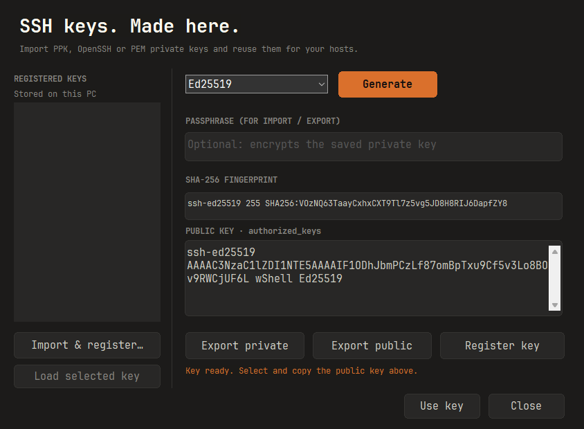

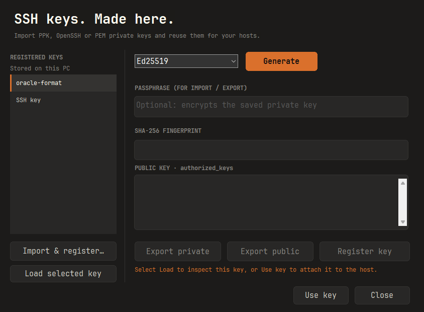

## SSH 비밀번호 저장

`New host` 또는 `Edit host`에서 `Authentication → Password`를 선택합니다. 기본값은 연결할 때 입력하는 방식입니다.

1. 서버 주소·포트·사용자 이름을 입력합니다.
2. `Save password encrypted on this PC`를 체크하고 비밀번호를 입력한 뒤 저장합니다.
3. 다음 연결부터 저장한 비밀번호를 사용합니다. 편집 시 비밀번호 칸을 비워 두면 기존 값을 유지하고, 새 값을 입력하면 교체합니다.
4. 체크를 해제하고 저장하거나 키 인증으로 전환하면 저장된 비밀번호를 삭제합니다. 호스트를 삭제해도 함께 삭제됩니다.

비밀번호는 [Windows DPAPI](https://learn.microsoft.com/en-us/windows/win32/api/dpapi/nf-dpapi-cryptprotectdata)로 현재 Windows 계정에 연결하여 암호화합니다. AppData의 세션 파일에는 암호문만 포함하며, 자식 프로세스 인수·환경변수·임시 파일로 평문을 전달하지 않습니다. 직접 지정한 `-pw` 실행 인자의 노출 범위는 [실행 인자 안내](#실행-인자로-ssh-접속)를 확인하세요. 서버·포트·사용자 이름에 연결해 보관하므로 연결 대상이 달라지면 다시 입력해야 합니다.

일반 SSH `password` 인증에 한 번 자동 입력하며, 거부되거나 복호화할 수 없으면 터미널에서 직접 입력합니다. 키 암호, 비밀번호 변경, keyboard-interactive/OTP 질문에는 자동 입력하지 않습니다.
**`.wshell` 내보내기·가져오기에는 암호문도 포함하지 않습니다.** 다른 PC나 Windows 계정에서는 비밀번호를 다시 저장하세요. 로그인된 동일 Windows 계정의 프로그램으로부터 비밀번호를 격리하는 기능은 아닙니다.

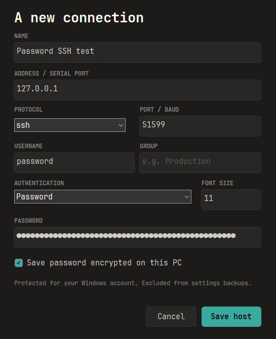

## 마우스 복사·붙여넣기 (Windows)

1.0.1부터 **일반 드래그로 텍스트를 선택하면 자동 복사**, **우클릭으로 붙여넣기**가 기본입니다. SSH에서 Codex CLI 같은 프로그램이 마우스 입력을 요청해도 같은 동작을 유지합니다. 기존 저장 연결에도 적용되며, 업데이트 후 연결을 다시 열면 새 기본값을 사용합니다. 여러 줄·한글 붙여넣기는 원격 프로그램이 요청한 bracketed paste 모드를 유지합니다.

`Settings → Selection & clipboard → Prefer mouse copy and paste`에서 현재 연결의 동작을 바꾸고 **Apply changes**로 즉시 적용할 수 있습니다. 다음 연결에도 유지하려면 해당 호스트의 **Host settings**에서 같은 항목을 저장하세요.

- **켜짐 (기본):** 드래그·우클릭은 시스템 클립보드를 사용하고, 휠은 터미널 기록을 스크롤합니다. 원격 앱의 마우스 클릭·드래그·휠 조작은 전달하지 않습니다.
- **꺼짐:** 원격 앱의 마우스 기능을 허용하고 기존 선택·버튼·클립보드 설정을 따릅니다. 앱이 마우스를 사용하는 동안에는 `Shift+드래그`·`Shift+우클릭`으로 복사·붙여넣기를 할 수 있습니다. `Shift overrides application's use of mouse`가 켜져 있어야 하며, 별도의 `Terminal → Features → Disable xterm-style mouse reporting`이 켜져 있으면 앱 마우스 입력은 계속 차단됩니다. [PuTTY 마우스 설정 설명](https://the.earth.li/~sgtatham/putty/0.85/htmldoc/Chapter4.html#config-mouseoverride)

`Ctrl+Shift+V`로 붙여넣기도 가능합니다. 단일 터미널과 분할 터미널에 같은 설정을 적용합니다. [설정 화면](../assets/screenshots/mouse-settings.png)

1.0.2부터 **휠로 위 기록을 읽는 동안 새 출력이 와도 스크롤 위치를 유지**합니다. 맨 아래로 내려가면 새 출력을 계속 따라갑니다. 이전 저장 연결에도 적용됩니다. 항상 최신 출력으로 이동하려면 `Settings → Window & scrollback → Reset scrollback on display activity`를 켜세요. 현재 연결에는 **Apply changes**, 다음 연결의 기본값에는 해당 호스트의 **Host settings**를 사용합니다. 1.0.1에서는 이 항목을 끄면 같은 스크롤 동작을 사용할 수 있습니다.

1.0.7부터는 **위 기록을 보다가 Enter 또는 숫자 키패드 Enter를 누르면 최신 화면으로 돌아갑니다.** `Reset scrollback on keypress`가 꺼진 기존 연결에도 적용하며, 일반 문자 입력과 서버 출력의 기존 스크롤 정책은 유지합니다. 동기 입력 대상에도 같은 동작을 적용합니다. 일반 화면·대체 화면에서 서버 에코 없이 Enter 복귀와 SSH 입력 중복 여부를 검사하는 회귀 테스트를 추가했습니다. Linux 교차 빌드·패키지 정적 검사는 통과했으며 Windows 실행 검증은 미실행입니다. [1.0.7 릴리스 노트](../docs/releases/1.0.7.md)에서 검증 범위를 확인하세요.

`35;68;23M`처럼 숫자가 입력되는 증상은 원격 앱이 켜 둔 마우스 좌표 보고가 셸 입력으로 전달된 경우에 생길 수 있습니다. 복사·붙여넣기 우선 모드에서는 1.0.1부터 좌표 전송을 차단합니다. 1.0.2는 앱 마우스 모드를 사용하는 경우에도 **Shift를 누른 포인터 이동**에 override를 적용하며, 앱이 마우스 보고를 끄지 않고 종료한 상황의 회귀 검증을 추가했습니다. [1.0.2 변경 내역](../docs/releases/1.0.2.md)

## 단축키와 컬러

| 단축키 | 동작 |
| --- | --- |
| `Ctrl+Shift+T` / 탭 줄의 `+` | 새 연결 화면 |
| `Ctrl+Shift+L` | 로컬 CMD 탭 |
| `Ctrl+Shift+D` | 현재 연결을 새 탭으로 복제 |
| `Ctrl+Tab` / `Ctrl+Shift+Tab` | 다음 / 이전 탭 |
| `Ctrl+Shift+W` | 현재 탭 닫기 |
| `Ctrl+Shift+R` | 현재 연결 다시 시작 |
| `Ctrl+Shift+H` | 왼쪽 탐색창 접기 / 펼치기 |
| `Ctrl+Shift+P` | 탐색창 펼치기 및 이름·주소 검색 |
| `Ctrl+Shift+C` / `Ctrl+Shift+V` | 터미널 복사 / 붙여넣기 |
| `Alt+1` / `Alt+2…9` | 작업 공간 / 연결 탭 1…8 |
| `F11` | 전체 화면 |
| `F2` (Windows SFTP 목록) | 선택한 파일·폴더 이름 변경 |
| `Delete` (Windows SFTP 목록) | 선택 항목 삭제, 확인창 표시 |
| `Y` / `N` / `Esc` (SFTP 삭제 확인창) | 삭제 승인 / 취소 / 취소, 기본 선택은 No |
| `F5` (Windows SFTP 목록) | 로컬·원격 목록 새로고침 |

Windows 1.0.9부터 SFTP 파일 목록에 포커스가 있을 때 위 단축키를 사용할 수 있습니다. 연결·전송 작업 중에는 차단되며, 경로 입력칸에서는 기존 텍스트 편집 동작을 유지합니다. [SFTP 단축키 안내](../docs/sftp.md#단축키-windows)

macOS: `⌘⇧L` 로컬 터미널, `⌘⇧T` 새 연결 화면, `⌘⇧D` 탭 복제, `⌘W` 탭 닫기, `⌘⇧R` 재연결, `⌘⇧[` / `⌘⇧]` 이전/다음 탭, `⌘C` / `⌘V` 복사/붙여넣기. `Tabs` 메뉴에서 탭 순서를 바꿀 수 있습니다.

터미널 종류는 `xterm-256color`이고 `COLORTERM=truecolor` 환경변수를 요청합니다.
서버가 환경변수 전달을 허용하지 않으면 원격 셸에서 `export COLORTERM=truecolor`를 설정하세요.
Codex 등 원격 TUI의 색상 자동 감지는 해당 프로그램과 서버 설정에도 영향을 받습니다.

## AppData 저장과 내보내기·가져오기

```
%LOCALAPPDATA%/wShell/  # 최초 실행 시 생성
  sessions/            # 세션 설정
  trust/               # 신뢰한 SSH 호스트 키
  cas/                 # SSH 호스트 인증기관
  workspace/           # 탐색창 표시 등 작업 공간 설정
  fonts/               # 검증된 내장 폰트 캐시, 앱에서만 사용
```

**실행에 필요한 파일은 EXE 하나이며, 설정은 현재 Windows 사용자의 AppData에 저장됩니다.** 일반적인 위치는 `C:\Users\<사용자>\AppData\Local\wShell`입니다. EXE 옆에 `data/`를 새로 만들지 않습니다. 같은 PC에서는 EXE를 옮기거나 교체해도 저장한 서버 목록을 그대로 사용합니다.

1. `Tools → Export settings…`에서 `.wshell` 백업을 저장합니다.
2. 다른 PC에 EXE와 백업을 가져간 뒤 `Tools → Import settings…`로 복원합니다.
3. 현재 저장 위치는 `Tools → Open AppData folder`에서 확인합니다.

**비밀번호는 Export/Import로 옮겨지지 않습니다. 암호화된 비밀번호도 백업에서 제외되며, 가져온 호스트의 비밀번호는 다시 입력해야 합니다.** 파일 선택 화면과 완료 안내에도 이를 표시합니다.

백업에는 세션·신뢰한 호스트 키·호스트 인증기관이 포함됩니다. 가져오기는 기존 이름의 세션이나 기존 호스트 키를 덮어쓰지 않습니다. 신뢰할 수 있는 백업만 가져오고 연결 전에 설정을 확인하세요.
이전 버전의 EXE 옆 `data/`가 있으면 최초 전환 시 AppData로 한 번 가져옵니다. 원본 폴더와 AppData의 기존 항목은 보존하며, 이후에는 AppData만 사용합니다. 이미 EXE만 이동했다면 이전 버전에서 내보낸 백업으로 가져올 수 있습니다.
설정은 기존 PuTTY 레지스트리와 분리됩니다.
SSH 비밀번호는 선택한 호스트에 한해 암호화해 저장하고 백업에서는 제외합니다. 프록시 암호는 저장하지 않으며, 개인키 파일은 복사하지 않고 경로만 참조합니다.
장치를 옮길 때는 개인키를 별도로 이동하고 경로를 다시 지정해야 할 수 있습니다. 설정 폴더와 `.wshell` 백업은 암호화된 비밀 저장소가 아닙니다.
테스트 또는 별도 데이터 위치에는 `WOOK_DATA_DIR` 환경변수를 사용할 수 있습니다.

macOS는 `~/Library/Application Support/wShell/`의 `settings.json`과 `known_hosts`에 저장합니다. 저장 비밀번호는 Keychain에 별도로 보관하며 `.wshell` 백업에서는 제외됩니다. 호스트 편집 시 비밀번호를 비워 두면 같은 접속 대상의 기존 값을 유지합니다. 저장 체크를 해제하거나 공개키 인증으로 바꾸면 저장 비밀번호를 삭제합니다.


## 추가 접속을 기존 창의 새 탭으로 열기

0.14.0부터 같은 Windows 로그온 세션·권한 수준·데이터 폴더로 실행한 추가 SSH 접속은 기존 wShell 창의 새 탭으로 열립니다. 같은 서버를 다시 클릭해도 새 탭을 만듭니다. 접속 인자 없이 재실행하면 기존 창을 표시하며, 최소화된 창은 복원합니다. `--help`, `--preview`와 내부 터미널 프로세스는 전달 대상에서 제외합니다. 이전 버전의 창은 이 기능을 지원하지 않으므로 교체 전에 종료하세요.

실행파일과 ZIP 내부 파일 이름은 항상 **`wShell.exe`**로 제공합니다. 기존 창의 새 탭으로 여는 기능은 일반 명령줄·바로가기·외부 프로그램 연동에 공통으로 적용되며 NGS 전용 기능이 아닙니다.

**선택 사항 — NGS 연동:** NGS 7.0.13.10 사용자 환경에서는 새 프로그램 등록이나 경로만 교체했을 때 인자가 전달되지 않았고, wShell 복사본을 기존 PuTTY 경로에 `putty.exe`라는 이름으로 배치했을 때 접속 인자가 전달되는 것을 확인했습니다. 같은 문제가 있는 환경에서만 사용자가 원본 PuTTY를 백업하고 `wShell.exe`의 별도 복사본을 해당 이름·경로에 배치하세요. 이름을 바꾼 파일을 별도로 배포하거나 빌드 과정에서 자동 생성하지 않습니다. 이는 해당 환경의 관찰 결과이며 NGS 전체 버전의 공식 연동 명세를 뜻하지 않습니다. wShell의 창 공유는 실행파일 이름·설치 폴더에 의존하지 않습니다.

추가 실행 프로세스는 같은 로그온 SID만 접근 가능한 로컬 Named Pipe로 요청을 전달하고 종료합니다. 데이터 폴더와 프로세스 권한 수준이 다르면 별도 창을 사용합니다. 암호는 추가 명령줄·로그·평문 파일에 기록하지 않으며, 기존 창에서 기존의 일회용 DPAPI 암호 처리를 적용합니다. NGS가 최초 실행 명령줄에 넣은 `-pw`의 노출 가능성은 그대로입니다. 전달 실패 시 명시적인 오류를 표시하고 자동 재전송하지 않습니다. 확인 응답이 유실되었다는 오류라면 기존 창을 확인한 뒤 재시도하세요.

Windows IPC 검사와 실제 NGS 연동 검증은 구분합니다. 현재 배포의 검증 범위는 [릴리스 노트](releases/1.2.2.md)를 확인하세요.
