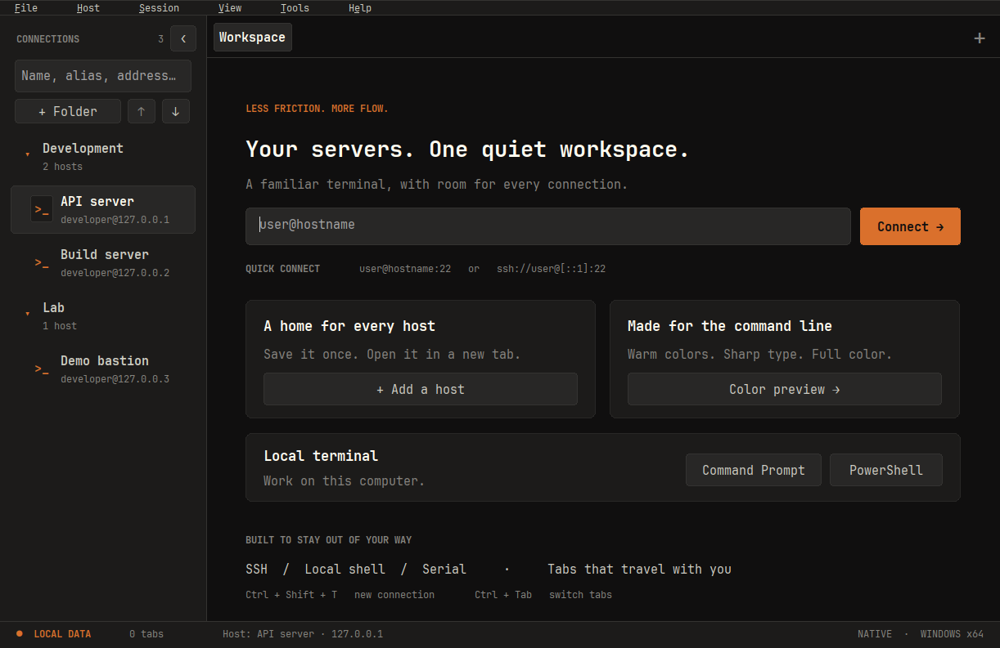
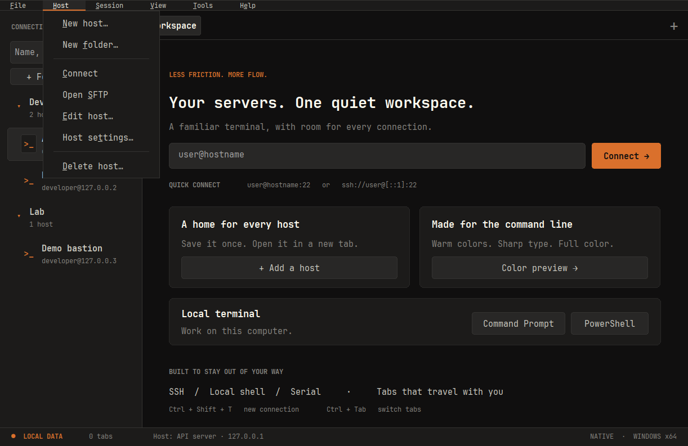

# Windows 메뉴바 사용과 검증

Windows 1.2.19부터 상단 작업 버튼을 메뉴바로 제공합니다. 1.2.20에서는 글자 주변 간격과 밝은 경계선을 다듬었습니다. 배포 파일과 검증 범위는 [1.2.20 릴리스 노트](releases/1.2.20.md)를 확인하세요. macOS·iPad UI는 변경하지 않았습니다.

## 현재 화면





위 이미지는 Windows 1.2.20 개발 빌드를 Linux의 Wine 8.0·Xvfb에서 96 DPI로 실행해 직접 캡처했습니다. 표시된 세 호스트는 `build/` 아래 격리 저장소에 만든 루프백 주소의 예시이며 서버에 접속하지 않았습니다. 메뉴·텍스트를 합성하거나 기존 스크린샷에 덧붙이지 않았습니다. 창 장식·글꼴 렌더링은 실제 Windows와 차이가 있을 수 있습니다.

상단 메뉴는 OS의 네이티브 높이에 맞는 공통 9pt 글꼴과 좌우 18px 여백을 사용합니다. 하위 메뉴는 11pt 글꼴을 유지하며 최소 38px 행 높이로 넓혔습니다. 수치는 96 DPI 기준이며 배율에 맞춰 조정합니다. 구분선은 어두운 회색 1px로 그려 메뉴 그룹을 구별하고, 메뉴바 빈 영역과 경계·팝업 메뉴 외곽에도 같은 테마를 적용합니다.

## 명령 위치

| 메뉴 | 기능 | 적용 대상 |
| --- | --- | --- |
| File | New connection, Command Prompt, PowerShell, Export/Import settings, Exit | 작업 공간·이 PC의 설정 |
| Host | New host, New folder, Connect, Open SFTP, Edit host, Host settings, Delete host | 탐색창에서 선택한 저장 호스트 |
| Session | Duplicate tab, Reconnect, Open Files, Settings, Save as host, Close tab | 현재 활성 탭 |
| View | Hosts panel, Find a connection, All tabs, 탭 전환, 1~4분할, Zoom, Sync keyboard, Command bar, Full screen, Color preview | 현재 작업 공간 |
| Tools | SSH key manager, Application settings, Open data folder | 이 PC의 사용자 데이터 |
| Help | Keyboard shortcuts, Open-source licenses, About wShell | 도움말·프로그램 정보 |

`Host → New host`는 선택한 폴더를 기본값으로 사용합니다. 선택한 저장 호스트가 없으면 접속·SFTP·편집·삭제가 비활성화됩니다. `Host settings`는 이때 새 연결 설정을 엽니다. 상태 표시줄은 선택한 호스트와 메뉴 명령의 적용 대상을 안내합니다.

`Session`의 항목은 탭 종류·연결 상태에 맞게 활성화됩니다. 기존 세션 도구 모음의 Files·Settings도 계속 활성 탭에 적용됩니다. 닫기·삭제·재접속의 기존 확인 절차와 설정 백업의 비밀번호 제외 정책을 유지합니다.

## 키보드 사용

- `F10`: 메뉴바로 이동합니다.
- `Alt+F/H/S/V/T/E`: File / Host / Session / View / Tools / Help를 엽니다.
- 방향키와 Enter: 메뉴를 탐색하고 명령을 실행합니다. 밑줄 친 문자로도 선택할 수 있습니다.
- Esc: 하위 메뉴를 닫고 메뉴바에서 다시 누르면 이전 입력 위치로 돌아갑니다.
- 기존 `Ctrl+Shift+T`, `Ctrl+Shift+P`, `Ctrl+Tab`, `Alt+1…9` 등 작업 공간 단축키를 유지합니다.

내장 SSH·로컬 터미널에서도 F10과 위 Alt 조합은 앱 메뉴를 조작합니다. 해당 키는 원격 프로그램으로 전달되지 않습니다. Ctrl/Shift와 조합한 키 및 AltGr 입력은 이 메뉴 단축키에 포함되지 않습니다.

## 구현과 검증

메뉴 상태·기존 명령 연결은 [main.cpp](../src/main.cpp), 네이티브 메뉴 표시와 접근성 이름은 [menu_bar.cpp](../src/menu_bar.cpp), 작업 공간과 터미널이 공유하는 메뉴 키 판별은 [menu_keys.h](../src/menu_keys.h)에 있습니다. Win32 메뉴가 마우스·키보드 탐색을 처리하며, 사용자 정의 그리기는 기존 글꼴·색상에 적용합니다. 접근성 이름은 Microsoft의 [owner-drawn 메뉴 지침](https://learn.microsoft.com/en-us/windows/win32/winauto/exposing-owner-drawn-menu-items)을 따릅니다.

Linux에서 Python 회귀 검사와 Windows 교차 빌드·정적 패키지 검사를 수행합니다. Windows에서는 다음 명령으로 격리 데이터와 루프백 서버만 사용해 메뉴 상태, 실제 키 입력·포커스 복귀와 화면을 확인합니다.

```powershell
node tests/ssh/connections-integration.cjs
node tests/ssh/focus-integration.cjs
node tests/ssh/message-integration.cjs
node tests/ssh/integration.cjs
```

`tests/workspace_smoke.inc`는 최소 크기 메뉴 배치·접근성 이름·호스트 상태별 활성 조건, `tests/focus_smoke.inc`는 내장 터미널의 F10·Alt+H·방향키·Esc와 취소 후 입력을 검사합니다. 메뉴 스타일 검사는 96·144·192 DPI의 측정·그리기 입력으로 여백과 구분선 픽셀을 검사하고, 프레임을 다시 그렸을 때 빈 공간과 경계 색상을 확인합니다. 이 입력별 검사는 실제 다중 DPI 모니터 이동 검사와 구분합니다.

`WOOK_TEST_MENU_STYLE_ONLY=1`로 `ui-smoke-tests.exe`를 실행하면 서버·인증 없이 이 스타일 검사와 실제 팝업의 네 면 경계색을 검사하고 종료합니다. 실행 파일 옆 `menu-style-result.txt`에 결과를 기록하고 `ui-menu-style.bmp`를 캡처합니다. 기존 `ui-menu-bar.bmp`도 비클라이언트 메뉴바를 포함하도록 수정했습니다. 실제 Windows 실행·다중 DPI 화면 확인은 Linux 빌드 및 Wine 검사 통과와 별개입니다.

Linux 작업 환경이므로 Windows 실기의 전체 UI·SSH 검사는 **미실행**입니다. 이번 화면 갱신을 위해 Wine에서 스타일 검사와 직접 캡처를 수행했으며 Windows 실기 통과로 표시하지 않습니다. 버전별 결과와 캡처 도구 출처는 [릴리스 노트](releases/1.2.20.md), 배포 출처와 검증 상태는 [manifest](../release/1.2.20/manifest.json)에 기록합니다. GitHub Actions는 실행하지 않았습니다.
